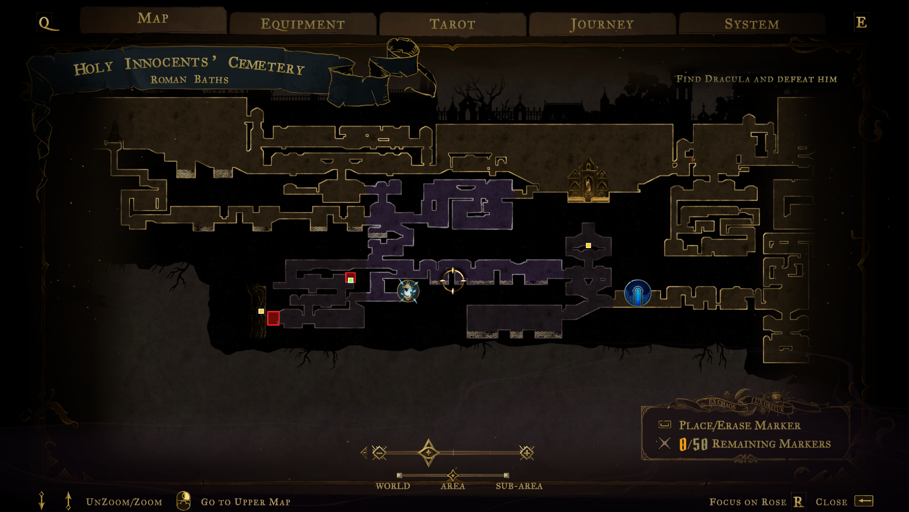

<h1 align="center">Map Hints</h1>
<p align="center"><b>Shows the secrets and collectibles you still miss, right on the in-game map of Castlevania: Belmont's Curse.</b></p>

<p align="center">
  <a href="LICENSE"></a>
  
</p>

<p align="center"></p>

Open the map and the mod draws what you have not found yet in the world the map shows:

| Marker | Meaning |
|---|---|
| **Red frame** (faint red fill) | undiscovered secret zone |
| **Gold square** | chest |
| **Pink-red square** | health upgrade |
| **Blue square** | mana upgrade |
| **Orange square** | attack book |
| **Teal square** | defense book |
| **Green square** | XP source (e.g. a statue) |

Things you already found or destroyed disappear. It works for every world on the map, not only the one you are in.
**F10** turns the highlights on or off at any time (the choice is remembered). The key is configurable.

> Early version: it needs data extracted from your own game install, and it has only been tested on one save. See "Known limits".

## Requirements
1. The **BepInEx 6 (IL2CPP)** mod loader in the game folder (build 6.0.0-be.789 is what this was made on).
   The [Spell Swap](https://github.com/PikselYT/belmonts-curse-spellswap) installer sets it up for you.
2. **Map data from your own game.** It is not included. Generate it with the companion tool
   [belmonts-curse-secret-hints](https://github.com/PikselYT/belmonts-curse-secret-hints): run `setup.bat`, then `run_extract.bat`.
   It writes `data/*.json`.

## Install
1. Build the plugin (see below) or take `MapHints.dll` from a release, and put it in `BepInEx\plugins\MapHints\`.
2. Copy `World_Biome_*.json` and `completion.json` from the hint tool's `data` folder into `BepInEx\plugins\MapHints\data\`
   (or set `DataDirectory` in the config to the hint tool's `data` folder).
3. Start the game and open the map. The first start with BepInEx is slow; that is normal.

## Options
`BepInEx\config\pikselyt.belmontscurse.maphints.cfg` (created on the first start):

| Option | Default | Meaning |
|---|---|---|
| `Enabled` | `true` | highlights on/off (F10 flips it) |
| `ToggleKey` | `F10` | keyboard key for the toggle |
| `ThresholdPercent` | `0` | show highlights only once a world's completion reaches this percentage; `0` = always |
| `ShowSecretZones` / `ShowCollectibles` | `true` | choose what to draw |
| `DataDirectory` | empty | folder with the data files; empty = `data` next to the plugin |

## How it works
* Markers are plain sprites on the map camera's layer, placed at world tile coordinates.
* The offset between the extracted data and the map differs per world, so it is measured at runtime from the game's own
  secret-zone map items (each sits at its zone's corner).
* "Found" is read live: secret zones from the game's exploration state, collectibles from the entity states
  (`{"activated": true}`) of the loaded save and the running world.

## Known limits
* Only what the hint tool can place is shown: secret zones, chests, HP/mana upgrades, attack/defense books, XP sources.
* Collectibles you take or destroy in the current session may only disappear after the game saves.
* A secret zone is a rectangle, not an entrance: it shows where the zone is, not how to get in.
* Keyboard toggle only; there is no gamepad binding yet.

## Build
Needs the .NET SDK and a game install where BepInEx has been started once (it generates `BepInEx\interop`).
```
dotnet build src/MapHints -c Release -p:GameDir="C:\path\to\Castlevania Belmont's Curse\"
```
The build copies the plugin into the game's `BepInEx\plugins\MapHints\` (disable with `-p:Deploy=false`).
Close the game first, or the DLL is locked.

Not affiliated with Konami. No game code or data is included; see [THIRD-PARTY-NOTICES.md](THIRD-PARTY-NOTICES.md).
